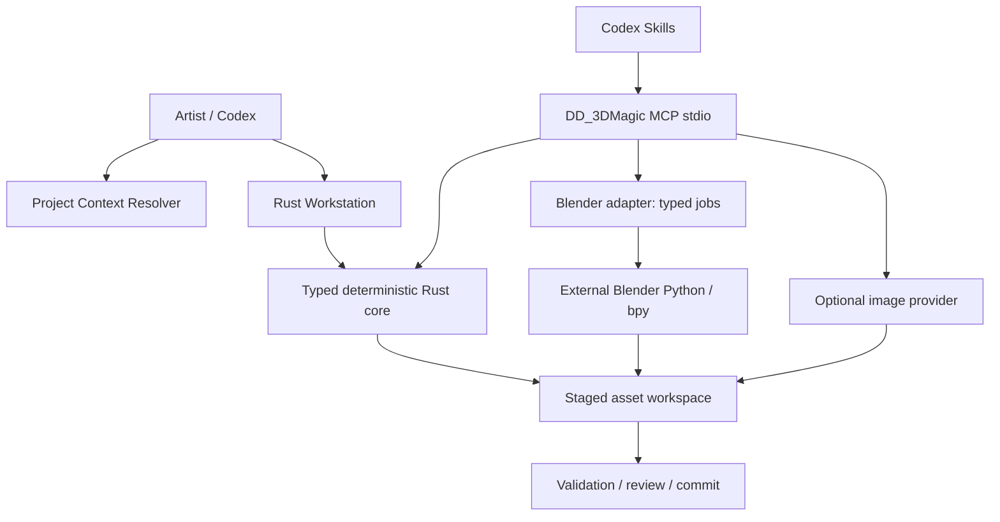

# DD_3DMagic — Product & Technical Design Document

**Версия документа:** 1.0 / 2026-11-10  
**Продукт:** отдельный нативный Rust desktop editor + локальный MCP server + Blender adapters + Codex Skills.  
**Статус:** утверждаемое техническое задание и кодовая основа v0.1; не завершённый продукт.  
**Целевая ОС первой очереди:** Windows 11, затем Linux. Blender 5.x, Godot как необязательная экспортная цель.  
**Исходные приоритеты:** контроль художника > чистота артефактов > неразрушаемость > скорость > автономность ИИ.

## 1. Ценность и границы

DD_3DMagic — локальная рабочая станция для художника среднего уровня, которому нужны быстрые, технически управляемые 3D-заготовки, референсы, UV-aware текстуры и материалы для дальнейшей ручной работы в Blender. Приложение не заменяет Blender и не стремится генерировать game-ready персонажей одним промптом. Его задача — сокращение рутины без потери точности, семантики или работы автора.

**Ключевой принцип:** *An operation is a small contract; a workflow is a composition of operations; a skill is an agent-facing procedure; an asset profile is project data.*

Из запроса «сделай текстуру для этой модели» должны запускаться inspect/context → UV-check → source generation/composition → preview → optional commit. Создание новой 3D-модели в эту цепочку не входит. Запрос «подправь палитру» не должен запускать ни Blender, ни Image API. Запрос «построй blockout» не требует сетевого генератора изображений.

За пределами MVP: риггинг, анимация, профессиональная скульптура, полноценный Photoshop, PSD round-trip, многопользовательская работа, полноценный realtime 3D renderer, server/cloud сервис, авторазметка сложной анатомии, автоматический full game-ready character pipeline.

## 2. Три слоя продукта

1. **Asset Workstation (Rust native):** окноподобный рабочий стол в стиле классического Photoshop: документ, палитра, слои, стек корректировок, инспектор, история, центральный Canvas и предпросмотр. CRT — язык интерфейса, не обработка изображений. Позже: встроенные UV canvas, ортографические проекции и отдельная 3D preview панель.
2. **Core & Operations (Rust):** каталоги/профили/манифесты, валидаторы, растровые операции, расчёт TD и локальных UV-искажений, граф зависимостей, композитинг, staging, операции над документом. Это библиотека, пригодная и для CLI/MCP, и для UI.
3. **Agent Integration (MCP + Skills):** официальный протокол MCP для контролируемых операций; `AGENTS.md` для правил, repo-local Skills для задач; Blender — внешний исполнитель через проверяемые командные адаптеры. Генерация изображения — опциональный provider, художественный вход, а не источник UV-истины.



Никаких прямых связей Codex → неограниченный Python на основной производственной дорожке. Отдельный отладочный адаптер может существовать в dev-среде, но не внутри общего доверенного API.

## 3. Рабочие сценарии

### 3.1. Готовая Blender-модель → текстура

1. Приложение/агент определяет путь `.blend`, выбранный asset_id и текущие UUID компонентов.
2. `resolve_asset_context` даёт модель, стиль, назначение, TD, размеры, palette policy, paths, naming, lock rules с указанием происхождения каждого значения.
3. Read-only Blender inspection выгружает evaluated world-space triangles, UV loop coords, material assignments; также hashes меша и UV на следующих этапах.
4. UV анализ проверяет валидность, density, anisotropy, в будущем overlaps/padding/island connectivity. Нельзя тихо изменять UV при провале TD.
5. Художественный input: проектная палитра + master reference + region-specific AI assets / собственные картинки / процедурные текстуры.
6. Метод выбирается по задаче: material-first; view-to-UV projection; UV-space compositing. Каждый метод может отсутствовать, если задача обходится без него.
7. Детерминированный композитор создаёт точный atlas в координатах существующих UV; работает с масками островов, семантикой материалов, protected regions.
8. Pixel pipeline приводит финал к пиксельной сетке, редактирует кластеры, обеспечивает padding; важно не путать ресайз с художественной пиксельной обработкой.
9. Blender preview + отдельный pixel preview → human review → только затем commit/export.

### 3.2. Текстовая команда к существующей текстуре

«Сделай металл на 10% менее насыщенным» → загрузка source layers → локальная adjustment operation → preview → save new variant. UV и генератор изображений не запускаются. При отсутствии source layers допускается пиксельный overwrite лишь нового staging-слоя, не исходника.

### 3.3. Новая модель

Дизайнерский референс и зафиксированный технический лист → блокинг в Blender → независимая сверка четырёх пар кадров и наложений (спереди, сбоку, сверху, 3/4) → исправление подтверждённых расхождений и повторная сверка → дальнейшая доводка. Большинство мешей надо строить из семантических частей с продуманной небольшой топологией, без автоматического subdiv/remesh. UV остаётся отдельной операцией.

### 3.4. Мастер-референсы

`Project Style Profile` описывает визуальную систему игры. `Asset Master Reference` связывает два материала конкретного ассета. Дизайнерский референс описывает замысел, стилизацию и материалы. Технический референс фиксирует форму, компоновку, привязки и четыре обязательных вида. По ним ревьюер сверяет форму модели кадр в кадр. Подтверждённое расхождение возвращает модель на исправление, а недостающий вид оставляет приёмку открытой. После утверждения новые версии сохраняются отдельно.

Подготовка листов описана в [dd-master-reference](../.agents/skills/dd-master-reference/SKILL.md), а проверка в [dd-model-review](../.agents/skills/dd-model-review/SKILL.md). Наложение совпадающих по разрешению кадров выполняет [compare_views.py](../scripts/references/compare_views.py). Источник, проекцию и масштаб сверяет ревьюер.

## 4. Философия Photoshop, а не копия Photoshop

- **Документ — главный объект** с известным размером, профилем и каналами.
- **Рабочий холст** занимает максимальную область; параметры и операции вокруг него.
- **Слои и маски** отделены от исходных изображений; настройки и коррекции сохраняются как записи, а не прямой destructive paint в исходник.
- **Выделение и target scope** определяют куда применяется операция: selected material / UV island / face set / alpha mask / component / whole asset.
- **History, compare, snapshot** позволяют увидеть что и почему изменилось; быстро вернуться к approved state.
- **Документы и инспекторы** могут открываться отдельно: texture image, UV atlas, concept, reference, future 3D preview.
- **Никакого «магического» workflow**: интерфейс предоставляет атомарные операции, рецепты (recipes) их связывают.

Нативный egui/eframe + внешний Blender, не Tauri/Electron: быстрота старта, небольшой стек, один язык в основном приложении. Docking позже через compatible egui_dock / egui_tiles только после проверки версий. MVP интерфейс строится штатными side/top/bottom panels и центральным изображением: это реальные структурные элементы, а не обещание полноценного docking.

## 5. CRT визуальная система

См. `04_UI_DESIGN_CRT.md` для токенов. Основа: чёрный с зелёным оттенком фон, тёмные контейнеры, фосфорные зелёные статусы, янтарные предупреждения, моноширинная служебная типографика, пунктирные сетки, тонкие 1px границы, небольшие радиусы (0–3 px), «старый терминал в мастерской».

Ограничения: никаких хроматических аберраций, scanlines, blur и bloom внутри изображений и финальных текстур. Даже в UI эффект scanlines должен быть настраиваемым/отключаемым и вне pixel-critical canvas. Contrast, keyboard focus, legibility важнее стилизации.

## 6. Модель данных и precedence

Иерархия: `Global Safe Defaults` → `Project` → `Style` → `Category` → `Asset` → `Explicit Operation Request`. Если значение не имеет безопасного default (например engine export path, overwrite policy, required shader variant), запрашивать уточнение или выдавать actionable error. Никаких «на глаз 256px потому что так красиво».

Файлы проекта:

```text
my-game-art/
  .assetlab/
    project.toml
    styles/lowpoly_pixel.toml
    categories/fps_weapon.toml
    staging/              # new results only
    cache/                # regenerable
    backups/              # future explicit snapshots
  assets/
    shotgun_001/
      asset.toml           # IDs, UV, locks, overrides
      references/master.yaml
      sources/*.blend
      textures/*.png
      output/               # approved only
```

Phase 1 в `dd_core` поддерживает workspace/project и asset discovery, layered context resolution, per-property provenance, v2 project/asset manifest types с read-only in-memory миграцией v1, face/material/reference identifiers и контроль source/reference SHA-256. Изменённый хэш только отражается в контексте; discovery никогда не переписывает исходник или manifest. Protected masks и Blender-сопоставление semantic face IDs остаются будущими возможностями.

Naming подчиняется шаблонам проекта: `T_{asset_id}_{surface}_{channel}_{width}.png`, `M_{asset_id}_{surface}`. Все имена нормализуются и проверяются; collision означает новую версию или ошибку, а не silent overwrite.

## 7. Операции как контракты

Каждый инструмент имеет входные данные, границу правок, выходной артефакт, техническую проверку, статус `preview`/`approved`, capability и код ошибки. Полный реестр и статусы в `03_API_OPERATIONS.md`.

Пример будущего контракта `texture.compose`:

```json
{
  "schema_version": 1,
  "operation": "texture.compose",
  "asset_id": "shotgun_001",
  "target_scope": {"component_ids": ["stock"]},
  "inputs": {"uv_hash": "sha256:...", "layers": ["wood_base", "wear"]},
  "settings": {"atlas": [256,256], "palette_profile": "lowpoly_pixel"},
  "write_mode": "stage_new",
  "expected_locks": ["barrels", "receiver"]
}
```

Если проверка защёлки lock или UV-hash не прошла — результат не коммитить. Такой формат **проектный**, а не реализованный MCP-интерфейс v0.1.

## 8. UV и texturing как основной инженерный риск

**Подход A / Material-first:** image/procedural source как поверхность. На острова накладывается orientation/scale согласно семантике (волокна дерева вдоль приклада и т.д.). Для MVP самый предсказуемый вариант.

**Подход B / Projection:** сгенерированный orthographic/3-4 дизайн на топологически подтверждённый render screen-space; координаты projection определяются камерой, матрицами и проверками visibility, а не моделями изображений. Каждый source получает confidence mask; holes и seams переходят на ручной review.

**Подход C / UV-space composition:** rasterize UV triangles в точные texel masks; привязка лиц к material/semantic ID; layer compositing + alpha mask + bleed/padding; output PNG строго по UV data. Не надо требовать от GPT Image точного соблюдения масок: официальные документы называют masks prompt-guided.

**True pixel art** это управляемые кластеры, ограниченная палитра, значимые пятна и единый уровень детали; `resize_nearest` и `palette_nearest` — низкоуровневые примитивы, не finished algorithm. Целевой pixel-art processing строится вокруг конечной пиксельной сетки, правил цветовых ramp, anti-noise, manual correction и seam-aware операций.

**TD:** базовый показатель в px/m, измеряется по мировым треугольникам и реальному разрешению. Анизотропия отдельно по singular values Jacobian. Сумма UV-площадей НЕ доказывает отсутствие перекрытий, а достаточное среднее TD НЕ гарантирует отсутствие искажений. Детали в `02_UV_AND_PIXEL_PIPELINE.md`.

## 9. Неразрушаемость и права

Состояния: `Imported → Working → Staged → Validated → Reviewed → Approved → Published`. Валидационный отказ возвращает `Staged` или `Rejected` с диагностикой; source и last approved остаются прежними. В v0.1 есть **только** неизменный исходный растр + стек корректировок + new-file PNG export. Настоящая persistent transaction engine пока не реализована.

Locks: geometry, UV, layer/texture, component, master reference. `Explicit User Override` не равен `unlock`: разблокировка отдельной осознанной командой с audit trail.

Нельзя делать destructive remesh/subdiv, менять UV packing после утверждения изображения или экспортировать поверх оригинала без явного подтверждения.

## 10. Производительность

UI должен отзываться на перемещение/zoom и не блокироваться сетью. Raster compositing GPU — НЕ стартовая необходимость: начать с CPU background workers, bounded image sizes, cached dirty regions в следующем этапе. MCP работает отдельным процессом: падение Python/Blender/image provider не должно рушить окно редактора. Сетевая генерация не является обязательной для запуска приложения. Пределы памяти и cancel/timeout обозначить на интерфейсе и в Job Contract.

Фоновый worker/queue появляется только когда будут реальны длительные операции. Не тащить Tokio в UI без необходимости; MCP уже на Tokio.

## 11. Релизные вехи

- **0.1 / Foundation** (то, что кладётся в архив): нативный raster workbench, конфиг resolver, TD+anisotropy, локальный MCP с 3 инструментами, read-only Blender UV export, материалы/инструкции для Codex.
- **0.2 / UV tooling:** Blender typed adapter, stable IDs, UV viewer, island graph, overlap policy, histogram TD, actual scope/locks.
- **0.3 / Texture composer:** per-region layers, exact mask rasterization, layer/UV dependency hashes, padding, texture inspection, project outputs.
- **0.4 / AI sources and projection:** pluggable ImageGen backend with human acceptance, orthographic projection and confidence maps; no blind direct UV image generation.
- **0.5 / Production reliability:** snapshots, commit/revert, change list, game engine smoke import, performance and cancellation.
- **1.0 only after field use:** robust Photoshop-like layer editor + review/approval + real Blender workflows + normal export. No speculative giant feature set.

## 12. Definition of Done / MVP

Successful artist flow: import an existing low-poly mesh with real UV → read style/category/asset policy → diagnose TD before texture operation → create a material-driven texture on exact UV islands → preview from multiple views → protect untouched regions → stage art and compare → approve → named .blend/PNG/glb handoff. The whole loop must operate without creating a new mesh and without losing previous manual changes.

**Do not call the initial Rust UI prototype this completed MVP.** It establishes source structure, typed context, basic raster tools and MCP transport only.
